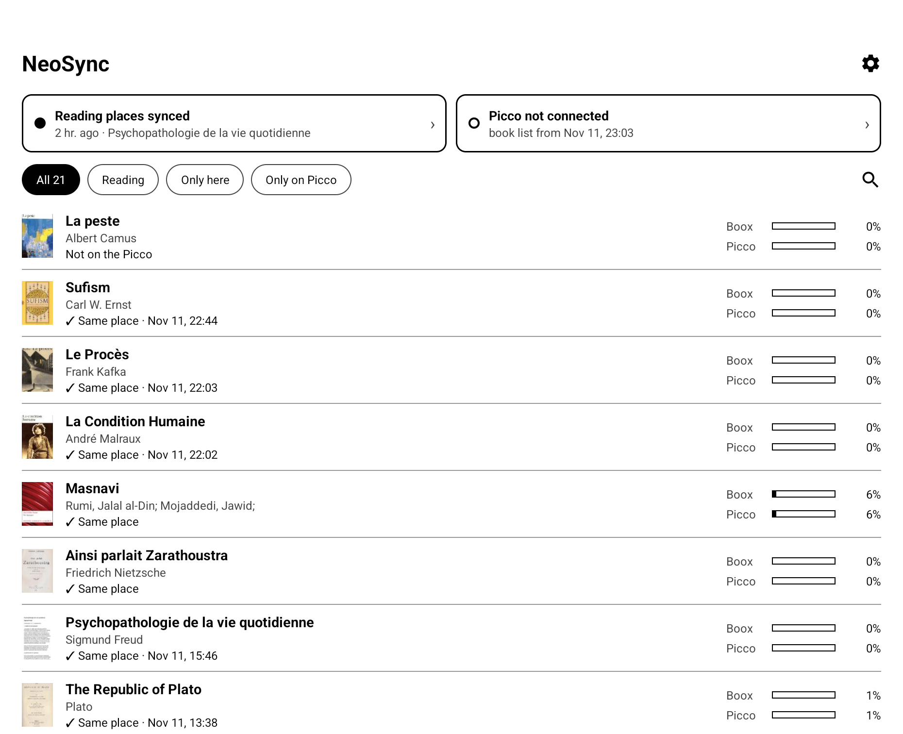

# NeoSync

**Read on your Boox tablet, pick up on your Picco at the same page, and back.**

NeoSync keeps your reading place in sync between **Neo Reader** on an Onyx
Boox and **CrossPoint** on a Boox Picco, or any other device that speaks
KOReader's progress-sync protocol ("kosync"). You keep reading in Neo Reader,
pen annotations included; NeoSync runs beside it. It can also send your books
to the Picco over Wi-Fi and fix the ones that show up there with a black
cover.

[**Download neosync.apk**](https://github.com/TryingVlad/neosync/releases/latest/download/neosync.apk)
· [All releases](https://github.com/TryingVlad/neosync/releases)
· [Report a problem](#reporting-a-problem)

<p align="center">
  
</p>

## Contents

- [What it does](#what-it-does)
- [What you need](#what-you-need)
- [Install](#install)
- [Set up](#set-up)
- [Syncing from the Picco](#syncing-from-the-picco)
- [Using NeoSync](#using-neosync)
- [Books on the Picco](#books-on-the-picco)
- [If something is off](#if-something-is-off)
- [Limitations](#limitations)
- [Privacy](#privacy)
- [How it works](#how-it-works)
- [Building](#building)
- [Credits](#credits)

## What it does

- **Syncs your place by itself.** Read on one device, open the book on the
  other, and it is on the right page.
- **Shows both devices in one library.** One row per book, with where you are
  on the Boox and on the Picco and how the two compare.
- **Lets you decide when they disagree.** Jump to the Picco's place, send
  yours instead, and undo a jump for 24 hours.
- **Sends books to the Picco** over Wi-Fi, one at a time or every book it
  doesn't have yet.
- **Gives coverless books a cover**, so the Picco stops showing a black tile.
- **Counts Picco reading in your Boox statistics.** Pages and days are exact;
  the time per page is an estimate.

## What you need

| | |
| --- | --- |
| **A Boox with Neo Reader** | Built and tested on a **Go 10.3 Gen 2 Lumi, firmware 4.2 (Android 15)**. Android 7.0 is the minimum. The project this was forked from was tested on a Poke3 (Android 10); that older position format is still in the code but has not been re-tested here. |
| **A Picco running CrossPoint** | It needs *Settings → Connectivity → CrossPoint Sync*, which the firmware the Picco ships with does not have. See [crosspointreader.com](https://crosspointreader.com). Boox does not support custom firmware and says it may void your warranty. |
| **The same book on both** | The **same EPUB with the same file name**. Only EPUBs are synced and listed: the Picco can't open PDFs or the other formats Neo Reader reads. |
| **A sync account** | The one you already use on the Picco, or a new one created in the app. |

## Install

1. Download [neosync.apk](https://github.com/TryingVlad/neosync/releases/latest/download/neosync.apk)
   and sideload it on the Boox.
2. If the icon is greyed out, long-press it and choose **Unfreeze**.

Later releases install over it. NeoSync checks GitHub once a day and tells
you on the home screen when a new version is out.

> **Coming from 8.0.1 or older?** Uninstall it first, then install the new
> one and sign in again. NeoSync's app ID changed in 8.1.0 (it is now
> `com.tryingvlad.neosync`), so Android sees it as a different app: it
> installs next to the old one instead of replacing it, and two NeoSyncs
> syncing the same books get in each other's way.

## Set up

1. **Follow the in-app guide.** It walks through the Picco's settings and
   asks for two permissions: book file access and notifications.
2. **Sign in** with the account you use on the Picco, or create one. Leave
   the server address empty for CrossPoint's default,
   `https://sync.crosspointreader.com`. A custom server must use `https://`.
3. **Let it run in the background.** In the Boox's *Settings → Apps →
   NeoSync*, allow background running and auto-start. Otherwise Boox power
   management can stop the sync.

The Picco needs the same account; see [Syncing from the Picco](#syncing-from-the-picco).

## Syncing from the Picco

The Boox syncs by itself. The Picco syncs when you ask it to, one book at a
time.

### Once: turn sync on

On the Picco, open *Settings → Connectivity → CrossPoint Sync*.

1. **Server address:** leave it empty. That is CrossPoint's free sync server,
   the same one NeoSync uses by default. If you set a custom server in
   NeoSync, enter the same one here.
2. **Account:** sign in with the same username and password as in NeoSync.
   **Sign Up** creates the account if you haven't made one in NeoSync.
3. **Sync Behavior:** *Smart sync* decides by itself which device is ahead.
   *Ask every time* lets you pick **Apply Remote** (take the place from the
   server) or **Upload Local** (send the Picco's place). Either way you still
   start each sync yourself; *Smart sync* only saves you the question.

Keep CrossPoint's book matching on file name, its default, unless you changed
it in NeoSync too.

### Each time: Sync Progress

1. Open the book on the Picco.
2. Press **Confirm**.
3. Choose **Sync Progress**.

To skip the menu, set *Settings → Controls → Front buttons → Menu long
press* to **CrossPoint Sync** on the Picco; holding Confirm in a book then
syncs directly.

The Picco needs Wi-Fi with internet for this. Do it at two moments:

| When | What happens |
| --- | --- |
| **Before reading on the Picco**, after reading on the Boox | The Picco jumps to where you stopped on the Boox. Until you do, the book's row in NeoSync says *Place sent*. |
| **After reading on the Picco**, before going back to the Boox | The Picco's place goes to the server. NeoSync picks it up when the Boox wakes, so the book opens on the right page in Neo Reader. |

If the book was open on screen in Neo Reader when the Picco's place arrived,
its row says *Picco is ahead · tap to jump*: close the book in Neo Reader and
jump from its sheet.

## Using NeoSync

### Home: your library

One row per book, whether it is on this Boox, on the Picco or on both. Each
row has a bar for your place on each device and one line saying how they
compare:

| The row says | What it means |
| --- | --- |
| *Same place* | Both devices are on the same page. |
| *Place sent* | The Picco catches up on its next Sync Progress. |
| *Read further here · syncs soon* | This Boox is ahead and is about to send. |
| *Picco is ahead · tap to jump* | Open the book's sheet to move here. |
| *Not synced yet* | NeoSync hasn't exchanged a place for this book so far. |
| *Only on the Picco* | The file isn't on this Boox. |

Filter with **All**, **Reading**, **Only here** and **Only on Picco**, or
search by title or author. The list turns in pages with the arrows at the
bottom instead of scrolling, so each page is a single e-ink refresh.

Two chips sit above the list. The left one is about reading places: synced
(and the last book), paused, or *not syncing*. The right one is about the
Picco: connected, or how old its last book list is. A chip turns black when
something is wrong, and tapping either one opens Connections.

Below them NeoSync shows at most one suggestion, the most useful first: the
fix for a known problem (a Wi-Fi without internet, a wrong password, sync
paused), connecting the Picco, sending the books it doesn't have, or giving
books a cover. **✕** puts a suggestion away. Long jobs report their progress
in the same spot with a single **Stop** button, and each row says how it
went.

### The book sheet

Tap a book to see your place on each device, when you last read there, and
which is more recent. One button does the obvious thing:

- **Jump to the Picco's place** when the Picco is ahead.
- **Send this place to the Picco** when this Boox is.
- **Send to Picco** when the Picco doesn't have the book.

Close the book in Neo Reader before jumping: a book that is open on screen
can't be moved. A jump can be undone for 24 hours with **Undo jump**. Smaller
links appear when they apply: use the other device's place instead, send the
file again, add a cover, open in Neo Reader.

### Connections

A diagram of the two links. Reading places travel between this Boox, the
sync server and the Picco over the internet. Books go straight from this Boox
to the Picco over Wi-Fi.

Under it, one card each:

- **This Boox**: book file access.
- **Sync server**: working, or what's wrong with the button that fixes it,
  and **Sync all books now**.
- **Picco**: connected or not. When it can't be found, the card lists the
  steps and **Look for the Picco** searches the Wi-Fi for it, so you never
  need its address. You can still type one in.

### Settings

The gear icon.

| Section | What's in it |
| --- | --- |
| **Sync** | Automatic sync on or off, and your account. |
| **Permissions** | Book file access and notifications, each with a button to allow it. |
| **Picco** | Where it was found, and the folder new books go to. |
| **Library** | Which of Neo Reader's folders the home list shows. This only narrows the list; syncing is not affected. |
| **Help** | The setup guide and *Report a problem*. |
| **Advanced** | Book matching, the sync server, and the size of the cover backups. |

## Books on the Picco

### Finding it

Open CrossPoint's **File Transfer** screen with both devices on the same
Wi-Fi, then use *Connections → Look for the Picco*. NeoSync keeps the Picco's
book list between visits and refreshes it quietly whenever the Picco
answers. When it can't be reached, the last list stays and the Picco chip
shows its age.

### Hotspot or shared network

Reading places need the internet; book files need the local network. If the
Boox joins the **Picco's own hotspot**, books can be sent but places can't
sync, because that network has no internet. NeoSync says so on the home
screen and offers a **Wi-Fi** button (Android doesn't let apps switch
networks themselves).

To do both at once, choose **File Transfer → Join a Network** on the Picco so
it joins your usual Wi-Fi next to the Boox.

### Sending books

The first time, NeoSync lists the Picco's folders and asks where books should
go, suggesting `books` when there is one. It remembers the answer; change it
in *Settings → Picco → Folder for new books*.

- From a book's sheet: **Send to Picco**.
- From the home suggestion: **Send** copies every EPUB the Picco doesn't
  have, after showing how many there are and their total size.

A book that is already on the Picco, in any folder, is never sent twice.
Files in hidden folders (NeoSync's cover backups, Onyx's cloud copies) are
never sent or changed. Files go straight to the Picco, so sending works even
while the sync server is rate-limiting.

### Fixing black covers

The Picco shows a black tile for a book without a cover it can read.
**Fix**, from the home suggestion, finds those books on both devices and
gives each one a cover; **Add a cover** on a book's sheet does a single one.
Sending a coverless book fixes it first.

- **Which picture:** one already in the book when its first page is just that
  picture or a picture is called "cover"; otherwise a picture of the book's
  first page.
- **What changes:** only the book's list of contents, never a chapter, so Neo
  Reader keeps your notes, highlights and place.
- **Backup:** the original is copied to `Books/.neosync-backup` first.
- **On the Picco:** the fixed file replaces the Picco's copy, which resets
  the Picco's own place in it. NeoSync saves every reading place to the
  server first; open the book on the Picco and choose Sync Progress to get
  yours back.
- **Books only on the Picco** are fixed only if you tick them.

Fixing covers needs book file access.

### Sync all books now

On Connections. For every book on both devices, NeoSync asks the server and
keeps the newest place: fetched when the Picco is ahead, sent when this Boox
is. Merely opening a book in Neo Reader doesn't count as reading, so a stale
place never overwrites the Picco's. Requests are spaced out for the server's
rate limit, and the job stops and says why at the first rate limit or network
error.

## If something is off

| What you see | What to do |
| --- | --- |
| A book stays at *Not synced yet* | Check that the file name is identical on both devices, then run **Sync Progress** on the Picco. A different edition or download counts as a different book. |
| The Picco is ahead but the Boox doesn't move | Close the book in Neo Reader, then jump from its sheet. An open book can't be moved. |
| Sync stops after a while or after a reboot | Allow background running and auto-start in *Settings → Apps → NeoSync*. |
| *Not syncing* while on the Picco's hotspot | That network has no internet. Use the **Wi-Fi** button, or **Join a Network** on the Picco. |
| The Picco can't be found | Open **File Transfer** on the Picco, put both devices on the same Wi-Fi, then **Look for the Picco**. |
| The icon is greyed out | Long-press it and choose **Unfreeze**. |
| Two NeoSync icons after updating from 8.0.1 or older | Uninstall the older one. From 8.1.0 the app has a new ID, so it can't replace earlier versions. |
| A book shows a black tile on the Picco | Open its sheet and choose **Add a cover**. |

### Reporting a problem

*Settings → Report a problem* copies a short report to the clipboard: device
model, firmware, Android version, a few NeoSync settings and the recent log.
Book names, file paths, document hashes and account details are removed, and
it fits in a Reddit comment.

Paste it with a few words about what happened into a
[GitHub issue](https://github.com/TryingVlad/neosync/issues) or a Reddit
comment or message. The app sends nothing by itself.

## Limitations

- A book open on screen can't be moved. Close it first.
- A book never opened in Neo Reader can't be moved ahead of time: Neo Reader
  only records its page count once it has been opened.
- Only EPUBs are listed, sent and matched with the Picco.
- Books are matched by file name, so both devices need the same file. Two
  editions of one book are two books to the server.
- KOReader on the same device with the same account will fight NeoSync.
- Calibre-Web-Automated's kosync bridge expects the plaintext password and
  will not work.
- Neo Reader's database layout depends on the firmware. Other Boox firmware
  versions may need adjustments.

## Privacy

- **On the device:** only the MD5 of your password, which is the credential
  the protocol uses.
- **On the sync server you choose:** your username, book identifiers (hashes,
  not titles) and positions, always over HTTPS.
- **On your local network only:** book files and the Picco's book list,
  between the Boox and the Picco, over plain HTTP as CrossPoint's
  file-transfer server speaks it.
- **To GitHub, once a day:** a request to its public API for the latest
  release. It carries nothing but the app version.

## How it works

A foreground service watches Onyx's `Metadata` content provider
(`content://com.onyx.content.database.ContentProvider/Metadata`), with a
60-second poll as a fallback. It restarts after boot.

- **Upload.** When Neo Reader's position changes, it is sent to the server.
- **Fetch.** When the server holds a newer position from another device, it
  is written into Neo Reader's row, so the book opens there next time. A
  book in the foreground is never interrupted.
- **Finding what changed.** The default server (crosspoint-sync) has a change
  feed: one request lists every book whose position another device changed
  since the last check. NeoSync reads it when the Boox wakes and every few
  minutes, so a book you read on the Picco is already on the right page when
  you open it on the Boox, even if it isn't your latest book. Plain kosync
  servers have no feed; there NeoSync asks about the books on both devices
  one by one, all of them when the Boox wakes and a few at a time otherwise.
- **Library rows.** A book's line comes from what the Boox already knows, so
  the home screen costs no requests to the server.

### Position mapping (firmware 4.x)

Neo Reader stores `current_page_position_v2` as
`{chapterIndex, nodePosition, chapterStartPosition, chapterEndPosition, chapterID, …}`:

- `chapterStartPosition` and `chapterEndPosition` are cumulative
  **uncompressed byte sizes of the EPUB's spine items**, in reading order.
- `nodePosition` is a **character** offset (UTF-8 code points) into the
  chapter file.

CrossPoint defines its sync percentage over the same cumulative spine bytes.
NeoSync therefore reads the EPUB's spine and converts exactly instead of
using `page / totalPages`, which can be several percent off because pages and
bytes don't grow at the same rate. Neo Reader accepts a bare `nodePosition`
with an empty `xpath` and starts the page there.

| Direction | Accuracy |
| --- | --- |
| Fetching into Neo Reader | Within a line or two. |
| Sending to the Picco | The paragraph Neo Reader last recorded, rounded to CrossPoint's own page breaks (about a page). |

EPUBs the app can't read fall back to page-based percentages.

### Book matching

A book is identified by the MD5 of its **file name**, CrossPoint's default.
*By file contents* (in *Settings → Advanced*) uses KOReader's partial MD5
instead and needs byte-identical files. Use the same mode on both devices.

An accented letter can be stored two ways in a file name: "é" as one
character, or "e" plus an accent mark. The Boox and the Picco don't always
agree, so NeoSync checks and sends both spellings of such names.

## Building

```bash
cd android
./gradlew assembleDebug testDebugUnitTest
```

Needs JDK 21 and Android SDK platform 36.1. The debug APK is signed with the
machine's debug key, so no secrets are needed.

Releases are built by [`.github/workflows/release.yml`](.github/workflows/release.yml)
when a `v*.*.*` tag is pushed, and signed with the project's release key from
the repository secrets (`KEYSTORE_BASE64`, `KEYSTORE_PASSWORD`, `KEY_ALIAS`,
`KEY_PASSWORD`).

## Credits

NeoSync is a fork of [eszter007/boox-kosync](https://github.com/eszter007/boox-kosync),
itself a fork of [Tukks/onyxbooxsync.koplugin](https://github.com/Tukks/onyxbooxsync.koplugin).
Its kosync compatibility is modeled on
[CrossPoint](https://github.com/crosspoint-reader/crosspoint-reader)'s
KOReaderSync client.

It is a client of the kosync protocol, whose reference server is
[koreader-sync-server](https://github.com/koreader/koreader-sync-server).
It shares no code with it and talks to any server that implements that API.

Released under the [MIT License](LICENSE).
